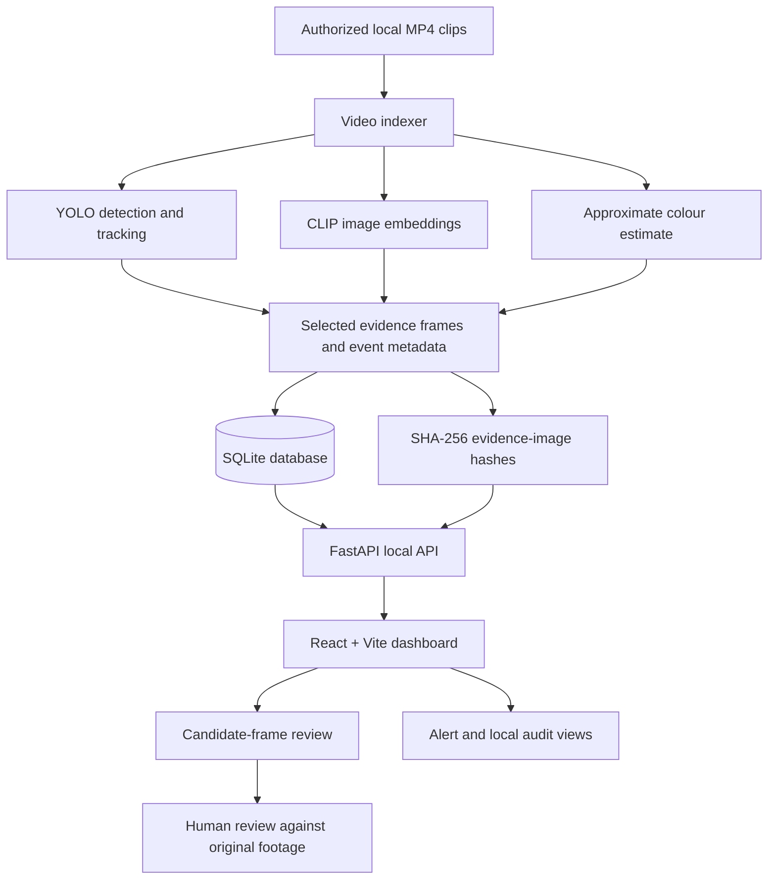

# Architecture and Data Flow

Nigaaani AI is a local-first prototype with a React dashboard, FastAPI endpoints, a video indexer, and a SQLite event store.

## Components
- **Indexer — `backend/app/index_videos.py`:** scans local folders for MP4 clips, samples frames, applies YOLO tracking, stores selected observations, calculates image embeddings, and hashes evidence images.
- **API — `backend/app/main.py`:** exposes health, camera/event search, evidence/video retrieval, alert, audit, and integrity-check endpoints.
- **SQLite:** stores per-clip event records, saved-frame filenames, hashes, embeddings, alerts, and local audit entries.
- **Frontend — `frontend/src/App.jsx`:** sends text queries to the local API and presents candidate frames, elapsed timestamps, similarity scores, alerts, and integrity checks.

## Data boundaries

The code does not synchronize timestamps from different cameras or resolve identities across clips. Query matches are retrieved by CLIP text/image similarity and should be inspected individually. Runtime footage, the local database, generated evidence frames, and downloaded model weights are deliberately not tracked by Git.
